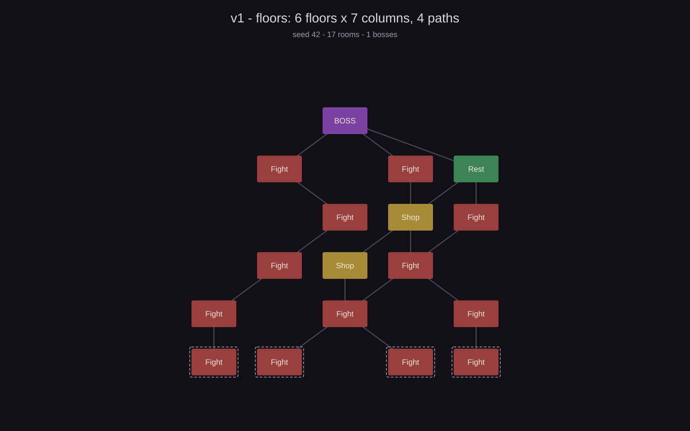

# 2026-10-21 · Vertical slice

**Commits:** `5ce0f83` (base project) · `700d2a7` (vertical slice)

## Objective

Go from a freshly created Unity 6.3 project to a **complete playable loop**: map, card
combat and rewards. A *thin vertical slice* so we can play something as early as possible.

## What was done

- Located and configured the existing project (URP 2D, new Input System).
- Connected the Editor to the agent through the **MCP relay** (`opencode.json`).
- Imported **TextMesh Pro Essential Resources** (without them nothing compiles).
- **Map** Slay the Spire style: 6 floors (5 normal + boss), 7 columns, 4 paths, edges that
  do not cross, deterministic per *seed*.
- **Combat** turn-based: 3 energy, draw 5 cards, block that resets, Vulnerable ×1.5.
- **Content**: 10 cards (Strike, Defend, Bash, Cleave, Pommel Strike, Iron Wave, Shrug It
  Off, Thunderclap, Heavy Blade, Battle Trance) and 3 enemies (Jaw Worm 44 HP, Cultist
  50 HP, The Guardian 90 HP as the boss).
- **Entire UI built from code** with `UIFactory`: no prefabs and no screens assembled in
  the Editor.
- Screens: map, combat, reward, rest, placeholder and end of run.
- `Assets/Scenes/Prototype.unity` scene with a single `Game` object.

## Map simulation

The floor map is deterministic per *seed*: 4 paths climb from floor 0 to the boss and the
edges that would cross are rejected. I ran it through the same benchmark as the two radial
maps (see the [2026-10-25 session](2026-10-25-radial-map.md)): **300 seeds × 40 runs =
12,000 traversals**, with a player who enters through a random room on floor 0 and then
picks a random edge.

*Seed 42. Rooms with a dashed outline are the possible entrances; the boss is at the top.
Click the image to see it full size.*

| Metric | Value |
|---|---|
| Rooms per map | 15.1 |
| Edges per map | 16.6 |
| Bosses | 1 (always) |
| Rooms with more than one exit | 2.3 |
| Edges that cross | 0 (worst map: 0) |
| Unreachable or overlapping rooms | 0 |
| Traversals that reach the boss | **100%** |
| Traversals with no way out | **0%** |
| Rooms per traversal | 5.0 (always; 6 counting the entrance) |

100% does not mean the map is better: it means there are **no direction decisions**. Edges
only go upwards, every room has at least one and every room on the last floor goes to the
boss, so every run follows exactly the same route of 5 rooms. The map is small (15 rooms)
because the 4 paths merge immediately: only 2.3 rooms per map offer more than one exit.
That is what led us to try the radial map with free movement.

## Files

### Added

- `Assets/Scripts/GameManager.cs` — entry point and screen switching
- `Assets/Scripts/Run/RunState.cs`
- `Assets/Scripts/Mapgen/MapGenerator.cs`
- `Assets/Scripts/Combat/CombatSession.cs`
- `Assets/Scripts/Content/CardLibrary.cs`
- `Assets/Scripts/Data/CardData.cs`, `Assets/Scripts/Data/EnemyData.cs`
- `Assets/Scripts/UI/UIFactory.cs`, `MapScreen.cs`, `CombatScreen.cs`, `RewardScreen.cs`, `SimpleScreens.cs`
- `Assets/Scenes/Prototype.unity`
- `Assets/TextMesh Pro/**` — TMP essential resources

## Verification

A full run in Play mode: map → combat won with **56/72 HP** → reward screen → back to the
map with **10 cards** in the deck. **0** compilation errors.

## Decisions

- **UGUI + TextMeshPro**, not UI Toolkit: it is what the genre asks for and what the
  reference does.
- **UI from code** instead of prefabs: fast iteration and everything versioned as text.
- **Content in C#** (`CardLibrary`) and not in ScriptableObjects yet: changing numbers
  means editing one line. It will be migrated when the volume grows.
- **A single scene**: screens are runtime panels.
- **No movement**: the game is a node map + turn-based combat, not a top-down exploration
  game.

## Pending

- [x] Push it to GitHub (done in the next session)
- [ ] See the deck and have test tools → becomes **Batch 1**
