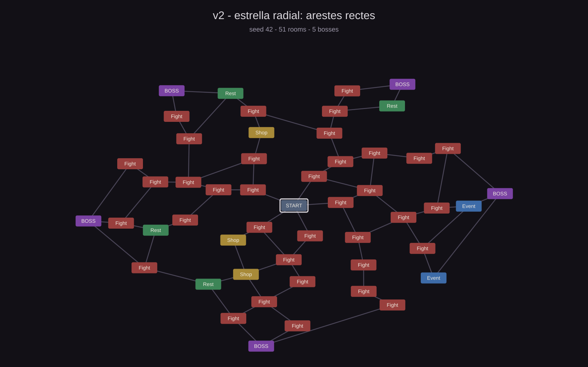
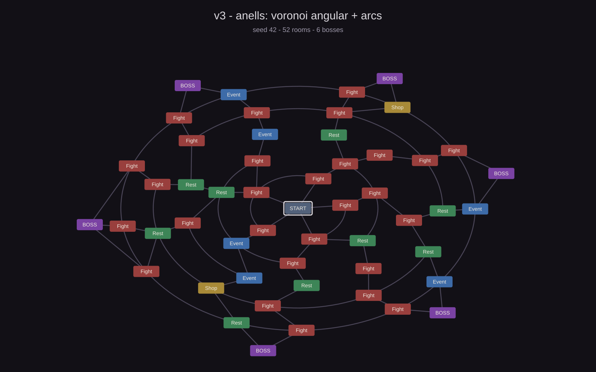

# 2026-10-25 · Mapa radial: de l'estrella als anells

**Durada:** tarda
**Commits:** `cf408e4` (mapa radial) · `231e2cc` (anells, més caps i zoom/pan) ·
`98b6304` (simulacions i docs) · `4bd2079` (repartiment de sales) · `7f00972` (rodeta
del deck)

## Objectiu

Trencar la rigidesa del mapa de pisos: 5 sales, una sola direcció i cap decisió de
camí. La idea és un mapa radial amb el centre com a entrada, anells de sales i diversos
caps a la vora, on es pugui triar per on anar. I que segueixi sent llegible: ni
creuaments, ni arestes que creuin el mapa, i amb zoom per veure'l sencer o de prop.

## Què s'ha fet

### v2 — l'estrella (`cf408e4`)

- Centre `Start`, 7 anells (5 de sales + 1 de caps) i sales que creixen de 5 a 15 per
  anell.
- **Moviment lliure i bidireccional**: es pot entrar a qualsevol sala veïna sense
  visitar, cap endins o cap enfora. Les sales visitades es tanquen. Si no queda cap
  veïna verge, apareix la pantalla de final de run (`END RUN`).
- Cada sala d'un anell enllaça amb les 1-2 sales **més properes en distància** de l'anell
  exterior; les que es quedaven sense porta es repesquen en un segon pas.
- 3-6 caps a l'anell exterior, un per sector.

El resultat és molt més gran que el mapa de pisos (50 sales), però **no es llegeix**: en
una el·lipse, enllaçar per distància fa que moltes arestes s'inclinin i es creuin (1,4
per mapa, fins a 9), i les arestes dels caps poden tornar a creuar l'anell 4. Sembla una
teranyina.

### v3 — els anells (`231e2cc`)

- **Enllaç per falques angulars**: cada sala de l'anell gran penja de la sala (o cap) de
  l'anell petit que té més a prop *en angle*. El mapa queda partit en falques centrades
  en l'anell petit, i dues carreteres de falques diferents no es poden creuar.
- Les sales del mateix anell s'uneixen amb **arcs** que ressegueixen l'anell, mai amb una
  recta que el talli.
- L'anell just abans dels caps és un **anell complet**: des de qualsevol branca es pot
  vorejar el mapa i triar un altre cap.
- **4-7 caps**, cadascun sobre el centre angular de les seves sales, perquè les arestes
  del darrer salt no surtin del seu anell.
- `LateralChance = 0,5` als anells 1-4; l'anell 5, just abans dels caps, és sempre
  complet.
- **Zoom i desplaçament**: roda o botons `+`/`−` (60%-220%), arrossegament amb el botó
  dret o central i `RESET VIEW`. El mapa es retalla dins la seva àrea perquè no
  trepitgi el HUD.

### Repartiment de sales (`4bd2079`)

- **50% combat, 15% descans, 10% botiga i 25% esdeveniment** (abans 62/18/10/10).
  L'anell 1 continua sent sempre de combat.
- Amb 40 sales sortejades (anells 2-5) surten unes **10 sales d'esdeveniment** i 4 de
  botiga per mapa; els combats baixen de 29,8 a 25,1 per mapa.
- Botiga i esdeveniment encara són pantalles *placeholder*: de moment el 35% de les
  sales sortejades no té contingut real. El repartiment va pensat per quan en tinguin.

### Bug: la rodeta del deck movia el mapa (`7f00972`)

`MapScreen` llegeix la roda (i els botons dret i central) directament de
`Mouse.current`, no de l'EventSystem. Amb el deck obert, l'scroll de les cartes
arribava també al mapa i li feia zoom (i, amb el botó dret, pan) al darrere.

- `DeckScreen` compta les capes obertes amb un `OpenCount` estàtic (`OnEnable` /
  `OnDisable`) i `MapScreen.Update` surt abans d'hora mentre n'hi hagi alguna.
- En tancar el deck el comptador torna a 0 i el mapa recupera roda i arrossegament.

## Simulació dels tres mapes

Mateix banc de proves per als tres algoritmes: **300 seeds × 40 excursions = 12.000
recorreguts** per mapa. Dues excursions per seed: una d'**atzar** (tria qualsevol veïna
verge) i una que **sempre mira cap enfora** (si pot, puja d'anell). La primera mesura el
mapa com a exploració; la segona, com a camí cap al cap. Al mapa de pisos no hi ha
diferència perquè només hi ha una direcció.

*Feu clic a les imatges per obrir-les a mida completa.*

*Seed 42. Els enllaços per distància fan arestes llargues i creuades: 1,4 creuaments per
mapa de mitjana, fins a 9.*

*Seed 42. El mateix tipus de mapa (unes 50 sales), ara amb falques, arcs i un anell
complet abans dels caps: 0 creuaments en 300 seeds.*

| Mètrica | v1 · pisos | v2 · estrella | v3 · anells |
|---|---|---|---|
| Sales per mapa | 15,1 | 50,5 | 51,5 |
| Arestes per mapa | 16,6 | 69,0 | 87,2 |
| Caps per mapa | 1 | 3-6 | 4-7 |
| Sales amb més d'una sortida | 2,3 | 20,0 | 9,0 |
| Arestes que es creuen (mitjana) | 0 | 1,44 | **0** |
| Arestes que es creuen (pitjor mapa) | 0 | 9 | **0** |
| Sales sobreposades o fora de l'àrea | 0 | 0 | 0 |
| Arestes que passen per sota d'un altre botó | 0 | 2,22 | 0,47 |
| Excursions al cap (atzar) | 100% | 86,1% | 75,1% |
| Excursions al cap (sempre cap enfora) | 100% | 100% | 100% |
| Excursions sense sortida (atzar) | 0% | 13,9% | 24,9% |
| Sales per excursió (atzar) | 5,0 | 7,71 | 11,35 |
| Sales per excursió (cap enfora) | 5,0 | 6,00 | 6,00 |

*Les xifres de les excursions no compten la sala d'entrada.*

**Què diuen els números**

- **v1 és un passadís, no un mapa.** 15 sales, 2,3 punts de bifurcació i sempre 5 sales
  de recorregut. El 100% d'excursions al cap i el 0% de culs-de-sac no són un mèrit de
  disseny: són la conseqüència que totes les arestes vagin cap amunt i que cada sala en
  tingui una.
- **v2 triplica el mapa però el trenca.** Passar de 15 a 50 sales i de 5 a 7,71 sales de
  recorregut és exactament el que es buscava, però 1,44 creuaments per mapa (fins a 9) i
  2,22 arestes que passen per sota d'un altre botó fan que no es pugui llegir d'un cop
  d'ull. En 222 de 300 mapes hi ha com a mínim una aresta així.
- **v3 arregla el dibuix i guanya exploració.** 0 creuaments i 11,35 sales per excursió
  aleatòria (abans 7,71). El preu és que una de cada quatre excursions aleatòries acaba
  en un cul-de-sac (24,9%) i que hi ha menys sales amb dues sortides (9,0 contra 20,0):
  cada sala de l'anell gran té una sola porta radial i la xarxa es tanca amb arcs.
- **Els culs-de-sac no són culpa dels caps.** Anar sempre cap enfora arriba al cap en 6
  sales el 100% de les vegades. Els culs-de-sac surten quan el jugador s'endinsa o va de
  costat: les connexions laterals són la palanca (`LateralChance`).
- **Els caps de la v3**: 4, 5, 6 o 7 caps en 72, 72, 82 i 74 de les 300 seeds.
- **Una taca que queda**: a la v3, en 74 de 300 mapes una aresta del darrer salt passa
  per sota del botó d'una sala veïna. És perquè el cap se situa al centre de la seva
  falca i una sala de la vora rep una aresta molt inclinada. Com que els botons es
  dibuixen a sobre, només desapareix un tros de línia; és estètic.

## Fitxers

### Afegits

- `Assets/Scripts/Mapgen/MapLayout.cs` (+ `.meta` generat per Unity) — geometria
  compartida entre generador i pantalla
- `docs/img/mapa-v1-pisos.svg`, `docs/img/mapa-v2-estrella.svg`,
  `docs/img/mapa-v3-anells.svg` — previews de la simulació
- `docs/sessions/2026-10-25-mapa-radial.md` (aquest fitxer)

### Modificats

- `Assets/Scripts/Mapgen/MapGenerator.cs` — de pisos a radial (v2) i d'arestes per
  distància a falques, arcs i 4-7 caps (v3)
- `Assets/Scripts/Mapgen/MapLayout.cs` — el·lipse ampla, `ProjectArc`, `ArcSteps` i
  60 px entre anells
- `Assets/Scripts/UI/MapScreen.cs` — mapa radial, moviment lliure, arcs, zoom i pan;
  amb `7f00972`, ignora roda i arrossegament mentre hi ha una capa oberta
- `Assets/Scripts/UI/DeckScreen.cs` — `OpenCount` estàtic per saber si el deck tapa el mapa
- `Assets/Scripts/GameManager.cs` — moviment lliure entre sales i final de run per
  cul-de-sac
- `Assets/Scripts/UI/SimpleScreens.cs` — pantalla `END RUN`
- `docs/arquitectura.md`, `docs/roadmap.md`, `docs/index.md` — regles, números i estat
- `docs/sessions/2026-10-21-vertical-slice.md` — la simulació del mapa de pisos

## Verificació

- Simulació: 300 seeds × 40 excursions per als tres mapes. A la v3, **0 creuaments**
  (pitjor mapa: 0), 0 sales inabastables, 0 solapaments i 0 sales fora de l'àrea; tots
  els controls del banc de proves passen.
- Play mode per MCP: mapa a 100% i a 176% amb zoom i pan; 5 de 5 clics encerten la sala
  correcta a 176%; els botons de zoom pugen i baixen amb el factor 1,12 i `RESET VIEW`
  torna al 100%; el desplaçament queda limitat a l'àrea.
- Una run conduïda sempre cap enfora arriba al cap i mostra `THE HOLLOW OPENS`.
- Bug de la rodeta: en Play mode, amb el deck obert (`OpenCount = 1`), injectar 120
  unitats de roda va deixar el zoom a 106% i el contingut del mapa a `(5,77, -102,96)`;
  tancat el deck (`OpenCount = 0`), la mateixa injecció va pujar el zoom a 118%
  (1,06 × 1,12). Sense errors ni avisos a la consola.
- La consola d'Unity no mostra errors després dels commits.
- Captures a `%TEMP%\opencode\unity-shots\` (no es comitegen).

## Decisions

- **Moviment lliure i bidireccional** en lloc de només cap enfora: el mapa és per
  explorar, i tornar enrere no ha de ser un càstig. Les sales visitades es tanquen perquè
  cada sala tingui contingut una sola vegada.
- **Cul-de-sac = final de run explícit** (`END RUN`), no un bloqueig silenciós. Més
  honest i més fàcil de mesurar.
- **Falques angulars en lloc de distància**: la distància sobre una el·lipse enganya
  (una sala pot ser "més a prop" del cap oposat) i genera creuaments. L'angle és la
  coordenada que ordena l'anell i la que fa el mapa planar.
- **Arcs per a les arestes del mateix anell**: una recta entre dues sales de l'anell
  talla l'anell i creua les arestes radials; l'arc no.
- **Anell complet abans dels caps**: dona una última decisió de cap sense afegir cap
  aresta que creui.
- **Caps sobre el centre de la seva falca**: és el que impedeix que les arestes del darrer
  salt surtin de l'anell. El compromís és que una sala de la vora rep una aresta inclinada
  que passa per sota del botó veí (0,47 per mapa).
- **El·lipse 1,45** en lloc de cercle: aprofita el 16:9 i dona més separació horitzontal
  entre sales.
- **`LateralChance` com a palanca**: és el número que decideix quant explora el jugador i
  quants culs-de-sac hi ha; ara 0,5.
- **4-7 caps** (abans 3-6): l'anell exterior és l'última decisió; amb 4-7 i l'anell
  complet, sempre n'hi ha més d'un a l'abast.
- **Un comptador estàtic al deck en lloc de passar la roda per l'EventSystem**:
  reencaminar el zoom a `IScrollHandler` seria més "correcte" a ulls d'UGUI, però
  canviaria el comportament a tot el mapa (el HUD també bloquejaria l'scroll) i el pan
  amb botó dret no és cap drag d'UI. El comptador resol el cas real amb tres línies.

## Pendents

- [~] 24,9% de culs-de-sac i 11,35 sales per run: **deixa de ser rellevant** amb el
      redisseny del mapa (radi de descobriment, retrocés). Es decidirà amb el mapa nou.
- [x] Playtest humà de la durada del run. **Fet**: el playtest funciona; la decisió de
      mida arribarà amb el mapa nou.
- [~] Polir l'aresta del darrer salt que passa per sota d'un botó (74 de 300 mapes):
      **acceptat** per ara; es farà quan s'acabi el mapa.
- [ ] Muntar el banc de proves dins el repo (`tools/`) si volem repetir les xifres sense
      reconstruir les tres versions.
- [~] Preguntes de zoom: **més o menys bé**; es perfilaran quan canviï el mapa, no cal
      tocar-ho ara.
- [ ] El comptador es diu `DeckScreen.OpenCount`: si la botiga o els esdeveniments
      tapen el mapa, caldrà un comptador comú de capes (o fer-los servir el mateix).

## Skills per a la propera sessió

| Skill | Per què |
|---|---|
| `status-effects-pipeline` | El següent punt del roadmap són 8 efectes i 15-20 cartes: on resol cada efecte, quan decau i com es veu |
| `deckbuilder-balance` | Números de referència i pressupost de la run (ara ~25 combats per mapa, ~11 sales per excursió) |
| `gameplay-architecture` | Si ataquem la botiga (#6), com encaixar-la amb `GameManager` i les pantalles |
| `unity-verify` | Per conduir el Play mode per MCP, injectar roda/tecles i comprovar el mapa sense dependre de l'usuari |
