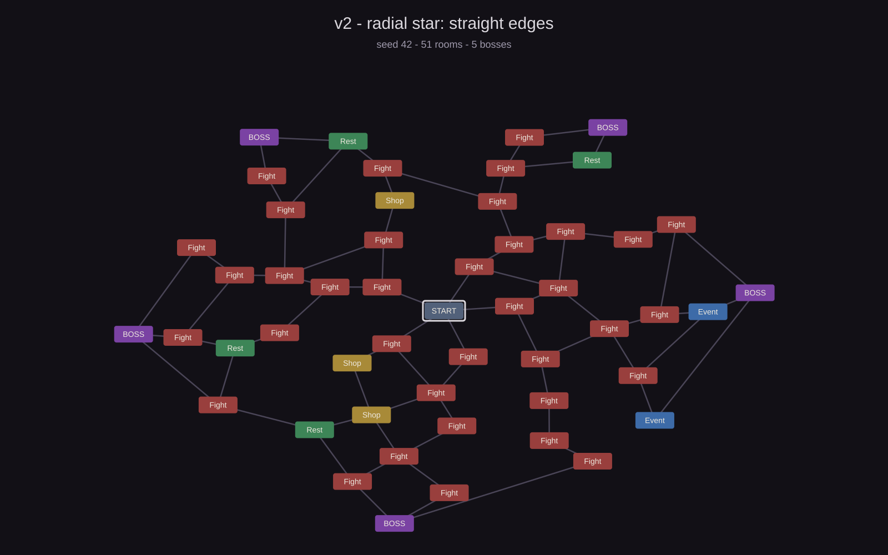
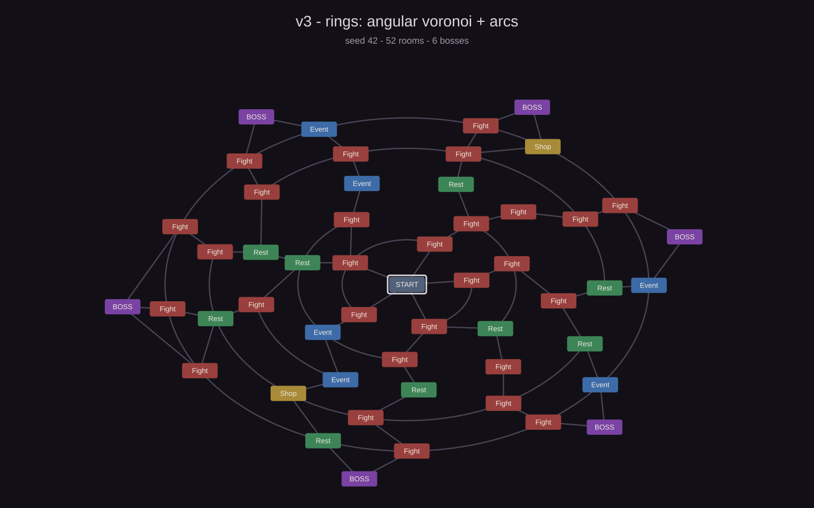

# 2026-10-25 · Radial map: from the star to the rings

**Duration:** afternoon
**Commits:** `cf408e4` (radial map) · `231e2cc` (rings, more bosses and zoom/pan) ·
`98b6304` (simulations and docs) · `4bd2079` (room distribution) · `7f00972` (deck wheel)

## Objective

Break the rigidity of the floor map: 5 rooms, a single direction and no path decisions. The
idea is a radial map with the centre as the entrance, rings of rooms and several bosses on
the edge, where you can choose which way to go. And it has to stay readable: no crossings,
no edges slicing across the map, and with zoom to see it whole or up close.

## What was done

### v2 — the star (`cf408e4`)

- `Start` centre, 7 rings (5 room + 1 boss) and rooms growing from 5 to 15 per ring.
- **Free, bidirectional movement**: you can enter any neighbouring room without visiting
  it, inwards or outwards. Visited rooms close. If no unvisited neighbour is left, the
  end-of-run screen appears (`END RUN`).
- Each room on a ring links to the 1-2 rooms **closest in distance** on the outer ring;
  those left without a door are picked up in a second pass.
- 3-6 bosses on the outer ring, one per sector.

The result is much bigger than the floor map (50 rooms), but it **does not read**: on an
ellipse, linking by distance makes many edges tilt and cross (1.4 per map, up to 9), and
the boss edges can cross ring 4 again. It looks like a spider web.

### v3 — the rings (`231e2cc`)

- **Linking by angular wedges**: each room on the big ring hangs off the room (or boss) on
  the small ring that is closest *in angle*. The map ends up split into wedges centred on
  the small ring, and two roads from different wedges cannot cross.
- Rooms on the same ring are joined with **arcs** that follow the ring, never with a
  straight line that cuts across it.
- The ring just before the bosses is a **complete ring**: from any branch you can go around
  the map and pick another boss.
- **4-7 bosses**, each on the angular centre of its rooms, so that the edges of the last
  hop do not leave their ring.
- `LateralChance = 0.5` on rings 1-4; ring 5, just before the bosses, is always complete.
- **Zoom and pan**: wheel or `+`/`−` buttons (60%-220%), drag with the right or middle
  button and `RESET VIEW`. The map is clipped inside its area so it does not cover the HUD.

### Room distribution (`4bd2079`)

- **50% combat, 15% rest, 10% shop and 25% event** (previously 62/18/10/10). Ring 1 is
  still always combat.
- With 40 rolled rooms (rings 2-5) you get about **10 event rooms** and 4 shop rooms per
  map; combats drop from 29.8 to 25.1 per map.
- Shop and event are still *placeholder* screens: for now 35% of the rolled rooms have no
  real content. The distribution is designed for when they do.

### Bug: the deck wheel moved the map (`7f00972`)

`MapScreen` reads the wheel (and the right and middle buttons) directly from `Mouse.current`,
not from the EventSystem. With the deck open, the card scroll also reached the map and
zoomed it (and, with the right button, panned it) behind.

- `DeckScreen` counts open overlays with a static `OpenCount` (`OnEnable` / `OnDisable`) and
  `MapScreen.Update` returns early while there is any.
- When the deck closes, the counter goes back to 0 and the map recovers wheel and drag.

## Simulation of the three maps

Same benchmark for the three algorithms: **300 seeds × 40 runs = 12,000 traversals** per
map. Two runs per seed: one **random** (picks any unvisited neighbour) and one that
**always looks outwards** (if it can, it climbs a ring). The first measures the map as
exploration; the second, as a path to the boss. On the floor map there is no difference
because there is only one direction.

*Click the images to open them full size.*

*Seed 42. Linking by distance creates long, crossing edges: 1.4 crossings per map on
average, up to 9.*

*Seed 42. The same kind of map (~50 rooms), now with wedges, arcs and a complete ring before
the bosses: 0 crossings across 300 seeds.*

| Metric | v1 · floors | v2 · star | v3 · rings |
|---|---|---|---|
| Rooms per map | 15.1 | 50.5 | 51.5 |
| Edges per map | 16.6 | 69.0 | 87.2 |
| Bosses per map | 1 | 3-6 | 4-7 |
| Rooms with more than one exit | 2.3 | 20.0 | 9.0 |
| Edges that cross (average) | 0 | 1.44 | **0** |
| Edges that cross (worst map) | 0 | 9 | **0** |
| Overlapping rooms or outside the area | 0 | 0 | 0 |
| Edges passing under another button | 0 | 2.22 | 0.47 |
| Runs reaching the boss (random) | 100% | 86.1% | 75.1% |
| Runs reaching the boss (always outwards) | 100% | 100% | 100% |
| Dead-end runs (random) | 0% | 13.9% | 24.9% |
| Rooms per run (random) | 5.0 | 7.71 | 11.35 |
| Rooms per run (outwards) | 5.0 | 6.00 | 6.00 |

*The run figures do not count the entrance room.*

**What the numbers say**

- **v1 is a corridor, not a map.** 15 rooms, 2.3 branching points and always 5 rooms of
  route. The 100% of runs reaching the boss and the 0% of dead ends are not a design merit:
  they are the consequence of every edge going upwards and every room having one.
- **v2 triples the map but breaks it.** Going from 15 to 50 rooms and from 5 to 7.71 rooms
  of route is exactly what we were after, but 1.44 crossings per map (up to 9) and 2.22
  edges passing under another button mean it cannot be read at a glance. In 222 of 300 maps
  there is at least one such edge.
- **v3 fixes the drawing and gains exploration.** 0 crossings and 11.35 rooms per random
  run (previously 7.71). The price is that one in four random runs ends in a dead end
  (24.9%) and that there are fewer rooms with two exits (9.0 against 20.0): every room on
  the big ring has a single radial door and the network closes with arcs.
- **The dead ends are not the bosses' fault.** Always going outwards reaches the boss in
  6 rooms 100% of the time. Dead ends appear when the player goes inwards or sideways:
  lateral connections are the lever (`LateralChance`).
- **The v3 bosses**: 4, 5, 6 or 7 bosses in 72, 72, 82 and 74 of the 300 seeds.
- **One remaining blemish**: in v3, in 74 of 300 maps an edge of the last hop passes under a
  neighbouring room's button. It is because the boss sits at the centre of its wedge and an
  edge room receives a very steep edge. Since the buttons are drawn on top, only a piece of
  line disappears; it is purely aesthetic.

## Files

### Added

- `Assets/Scripts/Mapgen/MapLayout.cs` (+ `.meta` generated by Unity) — geometry shared
  between generator and screen
- `docs/img/map-v1-floors.svg`, `docs/img/map-v2-star.svg`,
  `docs/img/map-v3-rings.svg` — simulation previews
- `docs/sessions/2026-10-25-radial-map.md` (this file)

### Modified

- `Assets/Scripts/Mapgen/MapGenerator.cs` — from floors to radial (v2) and from
  distance-based edges to wedges, arcs and 4-7 bosses (v3)
- `Assets/Scripts/Mapgen/MapLayout.cs` — wide ellipse, `ProjectArc`, `ArcSteps` and 60 px
  between rings
- `Assets/Scripts/UI/MapScreen.cs` — radial map, free movement, arcs, zoom and pan; with
  `7f00972`, ignores wheel and drag while an overlay is open
- `Assets/Scripts/UI/DeckScreen.cs` — static `OpenCount` to know whether the deck covers
  the map
- `Assets/Scripts/GameManager.cs` — free movement between rooms and end of run on a dead
  end
- `Assets/Scripts/UI/SimpleScreens.cs` — `END RUN` screen
- `docs/architecture.md`, `docs/roadmap.md`, `docs/index.md` — rules, numbers and state
- `docs/sessions/2026-10-21-vertical-slice.md` — the floor map simulation

## Verification

- Simulation: 300 seeds × 40 runs for the three maps. On v3, **0 crossings** (worst map: 0),
  0 unreachable rooms, 0 overlaps and 0 rooms outside the area; every benchmark assertion
  passes.
- Play mode over MCP: map at 100% and at 176% with zoom and pan; 5 of 5 clicks hit the right
  room at 176%; the zoom buttons go up and down with a 1.12 factor and `RESET VIEW` returns
  to 100%; panning stays limited to the area.
- A run driven always outwards reaches the boss and shows `THE HOLLOW OPENS`.
- Wheel bug: in Play mode, with the deck open (`OpenCount = 1`), injecting 120 wheel units
  left the zoom at 106% and the map content at `(5.77, -102.96)`; with the deck closed
  (`OpenCount = 0`), the same injection raised the zoom to 118% (1.06 × 1.12). No errors or
  warnings in the console.
- The Unity console shows no errors after the commits.
- Captures in `%TEMP%\opencode\unity-shots\` (not committed).

## Decisions

- **Free, bidirectional movement** instead of only outwards: the map is meant to be
  explored, and going back should not be a punishment. Visited rooms close so that each
  room has content only once.
- **Dead end = explicit end of run** (`END RUN`), not a silent block. More honest and easier
  to measure.
- **Angular wedges instead of distance**: distance on an ellipse lies (a room can be
  "closer" to the opposite boss) and generates crossings. Angle is the coordinate that
  orders the ring and the one that makes the map planar.
- **Arcs for same-ring edges**: a straight line between two rooms of the ring cuts the ring
  and crosses the radial edges; the arc does not.
- **Complete ring before the bosses**: it gives one last boss decision without adding any
  crossing edge.
- **Bosses on the centre of their wedge**: it is what stops the edges of the last hop from
  leaving the ring. The trade-off is that an edge room receives a steep edge that passes
  under the neighbouring button (0.47 per map).
- **Ellipse 1.45** instead of a circle: makes the most of 16:9 and gives more horizontal
  separation between rooms.
- **`LateralChance` as the lever**: it is the number that decides how much the player
  explores and how many dead ends there are; now 0.5.
- **4-7 bosses** (previously 3-6): the outer ring is the last decision; with 4-7 and a
  complete ring, there is always more than one within reach.
- **A static counter in the deck instead of routing the wheel through the EventSystem**:
  sending zoom to `IScrollHandler` would be more "correct" in UGUI's eyes, but it would
  change behaviour across the whole map (the HUD would block scrolling too) and right-button
  panning is not a UI drag. The counter solves the real case in three lines.

## Pending

- [~] 24.9% dead ends and 11.35 rooms per run: **it stops being relevant** with the map
      redesign (reveal radius, backtracking). It will be decided with the new map.
- [x] Human playtest of run length. **Done**: the playtest works; the size decision will
      come with the new map.
- [~] Polish the last-hop edge that passes under a button (74 of 300 maps): **accepted**
      for now; it will be done when the map is finished.
- [ ] Set up the benchmark inside the repo (`tools/`) if we want to reproduce the numbers
      without rebuilding the three versions.
- [~] Zoom questions: **more or less fine**; they will be sharpened when the map changes,
      there is no need to touch it now.
- [ ] The counter is called `DeckScreen.OpenCount`: if the shop or the events cover the map,
      a shared overlay counter will be needed (or have them use the same one).

## Skills for the next session

| Skill | Why |
|---|---|
| `status-effects-pipeline` | The next roadmap item is 8 effects and 15-20 cards: where each effect resolves, when it decays and how it looks |
| `deckbuilder-balance` | Reference numbers and run budget (now ~25 combats per map, ~11 rooms per run) |
| `gameplay-architecture` | If we tackle the shop (#6), how to fit it into `GameManager` and the screens |
| `unity-verify` | To drive Play mode over MCP, inject wheel/keys and check the map without depending on the user |
